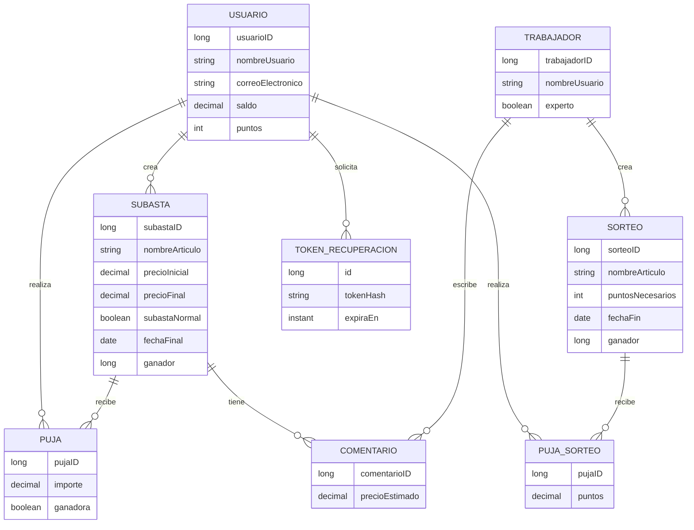

<div align="center">
  
  <h1 align="center">BidCo</h1>

  <p align="center">
    <strong>Plataforma web Full-Stack de subastas simuladas, subastas a ciegas y sorteos.</strong>
    <br /><br />
    <a href="https://bid-co.vercel.app/auction"><strong>Ver demostración en vivo</strong></a>
    <br /><br />
    <a href="https://github.com/imoroc/BidCo/actions/workflows/ci-validation.yml"></a>
    <a href="LICENSE"></a>
    
    
    
  </p>
</div>

---

## Qué es BidCo

BidCo es una aplicación desarrollada para la asignatura Servicios y Sistemas Web. Tiene una arquitectura cliente-servidor: un frontend Angular que consume una API REST de Spring Boot sobre PostgreSQL.

**Qué no es.** BidCo **no maneja dinero real**: no integra pasarelas de pago ni cobra nada. El saldo y los puntos son créditos virtuales que sirven para simular la participación, y el saldo se recarga sin pago (hasta 10 000 por operación).

## Funcionalidades

- **Subastas normales:** la puja visible sube el precio; hay que superar la puja actual.
- **Subastas a ciegas:** nadie ve las pujas hasta que termina; solo cuenta superar el precio base.
- **Sorteos:** se participa aportando puntos; el ganador sale de un sorteo ponderado por los puntos aportados.
- **Perfil de usuario:** datos, saldo, puntos, estadísticas con gráficos y opciones de privacidad (pujas anónimas, estadísticas y perfil visibles u ocultos).
- **Valoraciones de expertos:** comentarios con precio estimado sobre las subastas.
- **Búsqueda y filtros** por nombre, categoría, precio y fecha, con subastas y sorteos vencidos ocultos por defecto.
- **Recuperación de contraseña** por correo electrónico.

### Roles y permisos

| Acción | Visitante | Usuario | Experto | Administración |
|---|:-:|:-:|:-:|:-:|
| Ver listados, filtros y fichas de subastas y sorteos | Sí | Sí | Sí | Sí |
| Leer las valoraciones de expertos | Sí | Sí | Sí | Sí |
| Registrarse y recuperar la contraseña por correo | Sí | Sí | No | No |
| Pujar en subastas y participar en sorteos | No | Sí | No | No |
| Crear subastas | No | Sí | No | No |
| Recargar saldo, editar el perfil y ver estadísticas | No | Sí | No | No |
| Cerrar una subasta o sorteo ya vencido | No | Sí | No | No |
| Escribir y editar valoraciones | No | No | Sí | No |
| Crear sorteos | No | No | No | Sí |
| Dar de alta trabajadores y expertos | No | No | No | Sí |

Usuario y experto se identifican con un token JWT y tienen su propio acceso (`/login` y `/expert`). La administración (`/admin/login`) usa una sesión con cookie y una cabecera anti-CSRF; es una cuenta de trabajador no experto.

## Reglas de negocio

**Alta y saldo.** Una cuenta nueva empieza con saldo 0 y 10 puntos; ambos valores los fija el servidor. El saldo se recarga con un máximo de 10 000 por operación.

**Pujas en subastas.**

- No se puede pujar en una subasta propia, ni antes de su inicio ni después de su cierre.
- En una subasta **normal**, la puja debe superar el precio actual (o el base si aún no hay pujas). El importe de la puja líder queda retenido del saldo y se devuelve cuando alguien la supera.
- En una subasta **a ciegas**, basta con superar el precio base. El precio no se actualiza ni se muestran las pujas hasta el cierre, para no revelar la máxima. Una puja que no supera a la líder se registra sin retener saldo.
- Un usuario no puede gastar el mismo saldo dos veces en paralelo: la fila del usuario se bloquea durante la puja.

**Cierre de subastas.** Pasada la fecha final, gana la puja más alta y el ganador recibe 100 puntos (normal) o 200 (a ciegas). En las ciegas el precio definitivo se publica en ese momento. El cierre es **idempotente**: si ya hay ganador, repetir la petición no vuelve a repartir puntos, y dos cierres simultáneos no pueden puntuar dos veces.

**Sorteos.**

- Solo la administración los crea.
- Cada participación aporta puntos enteros, con un mínimo por sorteo. Los puntos se descuentan al participar.
- Al cerrarse, el ganador se elige con `SecureRandom` y probabilidad proporcional a los puntos aportados.
- El resultado es definitivo: un sorteo cerrado no se puede volver a tirar.

## Stack tecnológico

| Área | Tecnología |
|---|---|
| Frontend | Angular 22, TypeScript 6, CSS |
| Backend | Java 25, Spring Boot 4.1 |
| Persistencia | PostgreSQL, Spring Data JPA |
| Seguridad | JWT, BCrypt, CORS |
| Imágenes | Cloudinary |
| Documentación API | OpenAPI / Swagger |
| CI | GitHub Actions, CodeQL (configuración predeterminada), Dependabot |

## Requisitos

- Node.js 22 y npm.
- JDK 25.
- Maven (o Maven Wrapper).
- PostgreSQL.
- Credenciales de Cloudinary para las funciones de imágenes.

## Puesta en marcha

### 1. Clonar

```bash
git clone https://github.com/imoroc/BidCo.git
cd BidCo
```

### 2. Backend

Configura las siguientes variables de entorno. El secreto JWT es obligatorio y debe contener al menos 32 bytes UTF-8. Genera uno nuevo para cada entorno; no reutilices el valor de ejemplo de la documentación.

Linux/macOS:

```bash
export SPRING_DATASOURCE_URL="jdbc:postgresql://localhost:5432/bidco"
export SPRING_DATASOURCE_USERNAME="postgres"
export SPRING_DATASOURCE_PASSWORD="tu-password"
export JWT_SECRET="$(openssl rand -base64 48)"
export CLOUDINARY_API_KEY="tu-api-key"
export CLOUDINARY_API_SECRET="tu-api-secret"
```

PowerShell:

```powershell
$env:SPRING_DATASOURCE_URL="jdbc:postgresql://localhost:5432/bidco"
$env:SPRING_DATASOURCE_USERNAME="postgres"
$env:SPRING_DATASOURCE_PASSWORD="tu-password"
$env:JWT_SECRET=[Convert]::ToBase64String((1..48 | ForEach-Object { Get-Random -Maximum 256 }))
$env:CLOUDINARY_API_KEY="tu-api-key"
$env:CLOUDINARY_API_SECRET="tu-api-secret"
```

Arranca el backend:

```bash
cd backend
./mvnw spring-boot:run
```

En Windows utiliza `mvnw.cmd spring-boot:run`.

### 3. Frontend

```bash
cd frontend
npm ci
npm start
```

Angular estará disponible en `http://localhost:4200` y el backend en `http://localhost:8080`.

## Configuración de producción

Guarda las variables de entorno en el proveedor de despliegue (Render, por ejemplo), nunca en el repositorio. Mantén los logs de SQL y los mensajes internos desactivados en producción. Configura CORS únicamente con los orígenes reales del frontend.

## Arquitectura


El frontend es una aplicación de una sola página servida por Vercel. La API de Render guarda los datos en PostgreSQL, sube las imágenes a Cloudinary y envía el correo de recuperación con la API de Brevo. Render duerme el servicio gratuito tras un rato sin tráfico, por eso el frontend lo despierta al arrancar y un workflow (`keep-alive`) lo consulta cada 10 minutos.

## Modelo de datos



El esquema de referencia para PostgreSQL está en [`database/schema_postgres.sql`](database/schema_postgres.sql) (solo para desarrollo y demos: borra las tablas y recrea datos de ejemplo).

## API

Todas las rutas cuelgan de `/api`. Con `SWAGGER_ENABLED=true` la documentación interactiva está en `/swagger-ui.html`.

| Recurso | Endpoints principales | Acceso |
|---|---|---|
| Usuarios | `POST /usuarios` (registro), `POST /usuarios/login`, `GET/PUT /usuarios/{id}`, `PATCH /usuarios/{id}/password`, `PATCH /usuarios/{id}/recargar-saldo`, `GET/PUT /usuarios/{id}/privacidad`, `GET /usuarios/{id}/stats` | Registro y login públicos; el resto, usuario |
| Perfil público | `GET /usuarios/{id}/publico` | Público |
| Recuperación | `POST /usuarios/recuperar-contrasena`, `POST /usuarios/restablecer-contrasena` | Público |
| Subastas | `GET /subastas`, `GET /subastas/{id}`, `GET /subastas/filtrar`, `/filtro-normal`, `/filtro-ciega`, `/filtro-nombre` | Público |
| | `POST /subastas` (multipart), `PUT /subastas/final/{id}` | Usuario |
| | `GET /subastas/filtrar-creador`, `/filtro-mis-subastas`, `/filtro-mis-pujas` | Con sesión iniciada |
| Pujas | `POST /pujas`, `GET /pujas/subastas-usuario/{usuarioId}`, `GET /pujas/{id}` | Usuario |
| | `GET /pujas/mayor/{subastaId}` | Público |
| Sorteos | `GET /sorteos`, `GET /sorteos/{id}`, `GET /sorteos/filtro` | Público |
| | `PUT /sorteos/final/{id}` | Usuario |
| Participación en sorteos | `POST /pujas-sorteo`, `GET /pujas-sorteo/{id}` | Usuario |
| Comentarios | `GET /comentarios/{id}`, `GET /comentarios/subasta/{subastaId}` | Público |
| | `POST /comentarios/nuevo`, `PUT /comentarios/editar/{id}` | Experto |
| Trabajadores | `POST /trabajadores/login` | Público |
| | `PUT /trabajadores`, `GET /trabajadores/{id}`, `GET /trabajadores/buscar` | Trabajador o experto |
| | `POST /trabajadores` (alta) | Administración |
| Administración | `POST /admin/login`, `POST /admin/sorteos` | Sesión de administración |
| Estado | `GET /ping` | Público |

## Seguridad

- **Autenticación:** tokens JWT firmados con HS256 (el secreto debe tener al menos 32 bytes) y contraseñas con BCrypt. La administración usa una sesión de servidor con cookie `Secure` y cabecera anti-CSRF obligatoria.
- **Autorización por rol:** un filtro comprueba el rol del token en cada ruta, y los servicios verifican que el usuario autenticado sea el propietario del recurso.
- **Fuerza bruta:** los logins se limitan a 5 fallos cada 15 minutos y el tiempo de respuesta se iguala entre cuenta existente e inexistente. El límite vive en memoria de cada instancia (ver [decisiones técnicas](docs/decisiones-tecnicas.md)).
- **Recuperación de contraseña:** token aleatorio de un solo uso, guardado como hash y válido 30 minutos.
- **Datos:** el saldo y los puntos iniciales los asigna el servidor; las vistas públicas reciben un DTO reducido sin datos de contacto ni dirección; la entrada se valida con DTO.
- **Cabeceras y CORS:** `X-Content-Type-Options`, `X-Frame-Options`, `Referrer-Policy`, `Permissions-Policy` y CSP restrictiva y `Cache-Control: no-store` en las respuestas de la API; CORS limitado a los orígenes configurados.
- **Concurrencia:** pujas, cierres de subastas y sorteos usan bloqueo de fila para evitar gastar saldo o repartir puntos dos veces.
- **Análisis continuo:** CodeQL, SonarCloud, GitGuardian, revisión de dependencias en cada PR y Dependabot.

**Limitaciones conocidas.** El token JWT se guarda en `localStorage` del navegador, y el límite de intentos de login no se comparte entre instancias.

## Autores originales

- Iván Moro Cienfuegos
- Gonzalo Sánchez Maroto
