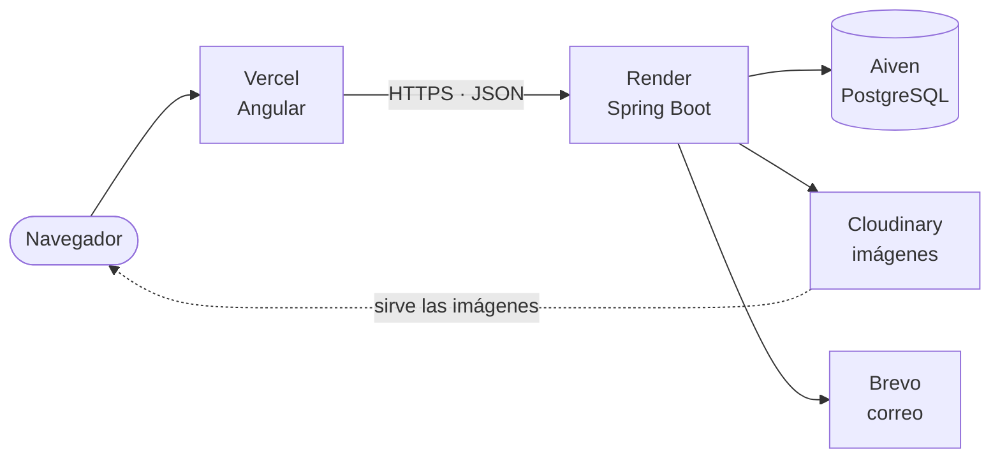
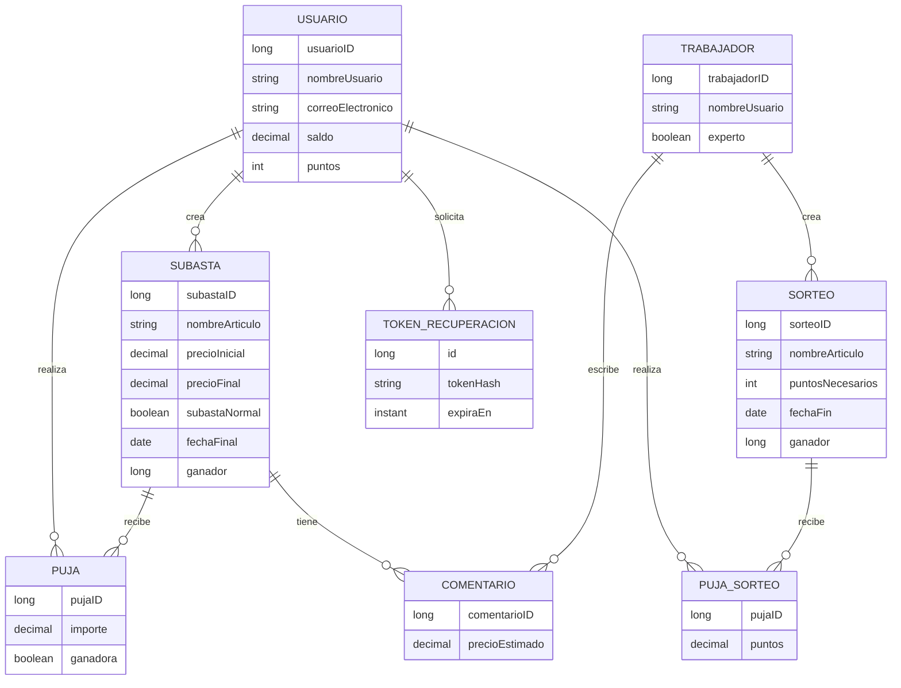

<div align="center">
  
  <h1 align="center">BidCo</h1>

  <p align="center">
    <strong>Plataforma web Full-Stack de subastas simuladas, subastas a ciegas y sorteos.</strong>
    <br /><br />
    <a href="https://bid-co.vercel.app/auction"><strong>Ver demostración en vivo</strong></a>
    <br /><br />
    <a href="https://github.com/imoroc/BidCo/actions/workflows/ci-validation.yml"></a>
    <a href="LICENSE"></a>
    
    
    
  </p>
</div>

---

## Qué es BidCo

BidCo es una aplicación desarrollada para la asignatura Servicios y Sistemas Web. Tiene una arquitectura cliente-servidor: un frontend Angular que consume una API REST de Spring Boot sobre PostgreSQL.

**Qué no es.** BidCo **no maneja dinero real**: no integra pasarelas de pago ni cobra nada. El saldo y los puntos son créditos virtuales que sirven para simular la participación, y el saldo se recarga sin pago (hasta 10 000 por operación).

## Funcionalidades

- **Subastas normales:** la puja visible sube el precio; hay que superar la puja actual.
- **Subastas a ciegas:** nadie ve las pujas hasta que termina; solo cuenta superar el precio base.
- **Sorteos:** se participa aportando puntos; el ganador sale de un sorteo ponderado por los puntos aportados.
- **Perfil de usuario:** datos, saldo, puntos, estadísticas con gráficos y opciones de privacidad (pujas anónimas, estadísticas y perfil visibles u ocultos).
- **Valoraciones de expertos:** comentarios con precio estimado sobre las subastas.
- **Búsqueda y filtros** por nombre, categoría, precio y fecha, con subastas y sorteos vencidos ocultos por defecto.
- **Recuperación de contraseña** por correo electrónico.

### Roles y permisos

| Acción | Visitante | Usuario | Experto | Administración |
|---|:-:|:-:|:-:|:-:|
| Ver listados, filtros y fichas de subastas y sorteos | Sí | Sí | Sí | Sí |
| Leer las valoraciones de expertos | Sí | Sí | Sí | Sí |
| Registrarse y recuperar la contraseña por correo | Sí | Sí | No | No |
| Pujar en subastas y participar en sorteos | No | Sí | No | No |
| Crear subastas | No | Sí | No | No |
| Recargar saldo, editar el perfil y ver estadísticas | No | Sí | No | No |
| Cerrar una subasta o sorteo ya vencido | No | Sí | No | No |
| Escribir y editar valoraciones | No | No | Sí | No |
| Crear sorteos | No | No | No | Sí |
| Dar de alta trabajadores y expertos | No | No | No | Sí |

Usuario y experto se identifican con un token JWT y tienen su propio acceso (`/login` y `/expert`). La administración (`/admin/login`) usa una sesión con cookie y una cabecera anti-CSRF; es una cuenta de trabajador no experto.

## Reglas de negocio

**Alta y saldo.** Una cuenta nueva empieza con saldo 0 y 10 puntos; ambos valores los fija el servidor. El saldo se recarga con un máximo de 10 000 por operación.

**Pujas en subastas.**

- No se puede pujar en una subasta propia, ni antes de su inicio ni después de su cierre.
- En una subasta **normal**, la puja debe superar el precio actual (o el base si aún no hay pujas). El importe de la puja líder queda retenido del saldo y se devuelve cuando alguien la supera.
- En una subasta **a ciegas**, basta con superar el precio base. El precio no se actualiza ni se muestran las pujas hasta el cierre, para no revelar la máxima. Una puja que no supera a la líder se registra sin retener saldo.
- Un usuario no puede gastar el mismo saldo dos veces en paralelo: la fila del usuario se bloquea durante la puja.

**Cierre de subastas.** Pasada la fecha final, gana la puja más alta y el ganador recibe 100 puntos (normal) o 200 (a ciegas). En las ciegas el precio definitivo se publica en ese momento. El cierre es **idempotente**: si ya hay ganador, repetir la petición no vuelve a repartir puntos, y dos cierres simultáneos no pueden puntuar dos veces. Un proceso programado del servidor revisa cada minuto las subastas y los sorteos vencidos con pujas o participaciones y los cierra, de modo que no hace falta que nadie abra su ficha (se ajusta con `CIERRE_INTERVALO_MS` y se desactiva con `CIERRE_ACTIVO=false`).

**Sorteos.**

- Solo la administración los crea.
- Cada participación aporta puntos enteros, con un mínimo por sorteo. Los puntos se descuentan al participar.
- Al cerrarse, el ganador se elige con `SecureRandom` y probabilidad proporcional a los puntos aportados.
- El resultado es definitivo: un sorteo cerrado no se puede volver a tirar.

## Stack tecnológico

| Área | Tecnología |
|---|---|
| Frontend | Angular 22.2, TypeScript 6.0, CSS, Chart.js 4 |
| Backend | Java 25, Spring Boot 4.1 |
| Persistencia | PostgreSQL, Spring Data JPA |
| Seguridad | JWT (JJWT 0.13), BCrypt, CORS |
| Mapeo | MapStruct 1.6 |
| Imágenes | Cloudinary |
| Correo | Brevo (API HTTPS) |
| Documentación API | OpenAPI / Swagger (springdoc 3.2) |
| Pruebas | JUnit y Mockito (backend), Jasmine y Karma (frontend) |
| CI y calidad | GitHub Actions, CodeQL, SonarCloud, GitGuardian, Dependabot |
| Despliegue | Vercel (frontend), Render (backend), Aiven (PostgreSQL) |

## Arquitectura



El frontend es una aplicación de una sola página servida por Vercel. La API de Render guarda los datos en PostgreSQL, sube las imágenes a Cloudinary y envía el correo de recuperación con la API de Brevo. Render duerme el servicio gratuito tras un rato sin tráfico, por eso el frontend lo despierta al arrancar y un workflow (`keep-alive`) lo consulta cada 10 minutos.

## Modelo de datos



El esquema de referencia para PostgreSQL está en [`database/schema_postgres.sql`](database/schema_postgres.sql) (solo para desarrollo y demos: borra las tablas y recrea datos de ejemplo).

## API

Todas las rutas cuelgan de `/api`. Con `SWAGGER_ENABLED=true` la documentación interactiva está en `/swagger-ui.html`.

| Recurso | Endpoints principales | Acceso |
|---|---|---|
| Usuarios | `POST /usuarios` (registro), `POST /usuarios/login`, `GET/PUT /usuarios/{id}`, `PATCH /usuarios/{id}/password`, `PATCH /usuarios/{id}/recargar-saldo`, `GET/PUT /usuarios/{id}/privacidad`, `GET /usuarios/{id}/stats` | Registro y login públicos; el resto, usuario |
| Perfil público | `GET /usuarios/{id}/publico` | Público |
| Recuperación | `POST /usuarios/recuperar-contrasena`, `POST /usuarios/restablecer-contrasena` | Público |
| Subastas | `GET /subastas`, `GET /subastas/{id}`, `GET /subastas/filtrar`, `/filtro-normal`, `/filtro-ciega`, `/filtro-nombre` | Público |
| | `POST /subastas` (multipart), `PUT /subastas/final/{id}` | Usuario |
| | `GET /subastas/filtrar-creador`, `/filtro-mis-subastas`, `/filtro-mis-pujas` | Con sesión iniciada |
| Pujas | `POST /pujas`, `GET /pujas/subastas-usuario/{usuarioId}`, `GET /pujas/{id}` | Usuario |
| | `GET /pujas/mayor/{subastaId}` | Público |
| Sorteos | `GET /sorteos`, `GET /sorteos/{id}`, `GET /sorteos/filtro` | Público |
| | `PUT /sorteos/final/{id}` | Usuario |
| Participación en sorteos | `POST /pujas-sorteo`, `GET /pujas-sorteo/{id}` | Usuario |
| Comentarios | `GET /comentarios/{id}`, `GET /comentarios/subasta/{subastaId}` | Público |
| | `POST /comentarios/nuevo`, `PUT /comentarios/editar/{id}` | Experto |
| Trabajadores | `POST /trabajadores/login` | Público |
| | `PUT /trabajadores`, `GET /trabajadores/{id}`, `GET /trabajadores/buscar` | Trabajador o experto |
| | `POST /trabajadores` (alta) | Administración |
| Administración | `POST /admin/login`, `POST /admin/sorteos` | Sesión de administración |
| Estado | `GET /ping` | Público |

## Seguridad

- **Autenticación:** tokens JWT firmados con HS256 (el secreto debe tener al menos 32 bytes) y contraseñas con BCrypt. La administración usa una sesión de servidor con cookie `Secure` y cabecera anti-CSRF obligatoria.
- **Autorización por rol:** un filtro comprueba el rol del token en cada ruta, y los servicios verifican que el usuario autenticado sea el propietario del recurso.
- **Fuerza bruta:** los logins se limitan a 5 fallos cada 15 minutos y el tiempo de respuesta se iguala entre cuenta existente e inexistente. El límite vive en memoria de cada instancia (ver [decisiones técnicas](docs/decisiones-tecnicas.md)).
- **Recuperación de contraseña:** token aleatorio de un solo uso, guardado como hash y válido 30 minutos.
- **Datos:** el saldo y los puntos iniciales los asigna el servidor; las vistas públicas reciben un DTO reducido sin datos de contacto ni dirección; la entrada se valida con DTO.
- **Cabeceras y CORS:** `X-Content-Type-Options`, `X-Frame-Options`, `Referrer-Policy`, `Permissions-Policy` y CSP restrictiva y `Cache-Control: no-store` en las respuestas de la API; CORS limitado a los orígenes configurados.
- **Concurrencia:** pujas, cierres de subastas y sorteos usan bloqueo de fila para evitar gastar saldo o repartir puntos dos veces.
- **Análisis continuo:** CodeQL, SonarCloud, GitGuardian, revisión de dependencias en cada PR y Dependabot.

**Limitaciones conocidas.** El token JWT se guarda en `localStorage` del navegador, y el límite de intentos de login no se comparte entre instancias.

## Puesta en marcha

### Requisitos

- Node.js 22 y npm.
- JDK 25 (el repositorio incluye Maven Wrapper).
- PostgreSQL.
- Credenciales de Cloudinary para subir imágenes.
- Opcional: cuenta de Brevo para el correo de recuperación de contraseña.

### 1. Clonar

```bash
git clone https://github.com/imoroc/BidCo.git
cd BidCo
git checkout deploy
```

### 2. Base de datos

Crea una base de datos PostgreSQL. Con `DDL_AUTO=update` (valor por defecto) Hibernate crea las tablas al arrancar. Si prefieres partir de datos de ejemplo, ejecuta [`database/schema_postgres.sql`](database/schema_postgres.sql); necesita la extensión `pgcrypto` y **borra las tablas existentes**, así que no lo uses con datos reales.

### 3. Backend

Configura las variables de entorno. El secreto JWT es obligatorio y debe tener al menos 32 bytes; genera uno nuevo para cada entorno. En [`.env.example`](.env.example) tienes la lista completa.

Linux/macOS:

```bash
export SPRING_DATASOURCE_URL="jdbc:postgresql://localhost:5432/bidco"
export SPRING_DATASOURCE_USERNAME="postgres"
export SPRING_DATASOURCE_PASSWORD="tu-password"
export JWT_SECRET="$(openssl rand -base64 48)"
export CLOUDINARY_API_KEY="tu-api-key"
export CLOUDINARY_API_SECRET="tu-api-secret"
# Solo en local, sin HTTPS:
export SESSION_COOKIE_SECURE="false"
export SESSION_COOKIE_SAME_SITE="lax"
```

PowerShell:

```powershell
$env:SPRING_DATASOURCE_URL="jdbc:postgresql://localhost:5432/bidco"
$env:SPRING_DATASOURCE_USERNAME="postgres"
$env:SPRING_DATASOURCE_PASSWORD="tu-password"
$env:JWT_SECRET=[Convert]::ToBase64String((1..48 | ForEach-Object { Get-Random -Maximum 256 }))
$env:CLOUDINARY_API_KEY="tu-api-key"
$env:CLOUDINARY_API_SECRET="tu-api-secret"
$env:SESSION_COOKIE_SECURE="false"
$env:SESSION_COOKIE_SAME_SITE="lax"
```

Arranca el backend:

```bash
cd backend
./mvnw spring-boot:run
```

En Windows utiliza `mvnw.cmd spring-boot:run`. La API queda en `http://localhost:8080`.

### 4. Frontend

```bash
cd frontend
npm ci
npm start
```

Angular queda en `http://localhost:4200` y apunta al backend local (`src/environments/environment.development.ts`).

### Recuperación de contraseña por correo

El flujo es: el usuario pide el enlace en `/forgot-password`, la API genera un token aleatorio, guarda solo su hash (válido 30 minutos) y envía por Brevo un enlace a `/reset-password` con ese token; al usarlo, el token queda invalidado. Para activarlo define:

| Variable | Descripción |
|---|---|
| `BREVO_API_KEY` | Clave de la API de Brevo. |
| `MAIL_FROM` | Remitente verificado en Brevo. |
| `MAIL_FROM_NAME` | Nombre del remitente (por defecto `BidCo`). |
| `FRONTEND_URL` | URL pública del frontend, base del enlace del correo. |

Sin `BREVO_API_KEY` y `MAIL_FROM` la función queda desactivada y la API responde 503 en lugar de simular el envío.

## Pruebas y CI

```bash
# Backend (compila y ejecuta las pruebas)
cd backend && ./mvnw clean verify

# Frontend
cd frontend && npm test
```

El workflow [`CI Validation`](.github/workflows/ci-validation.yml) se ejecuta en cada PR hacia `deploy` y en cada push a `deploy` y `master`:

- **Frontend:** `npm ci`, `npm audit --omit=dev`, pruebas con Chrome headless y build de producción.
- **Backend:** `mvn clean verify` con Java 25.
- **Revisión de dependencias** en las PR.

Además, CodeQL analiza el código, SonarCloud mide calidad y duplicación, GitGuardian busca secretos y Vercel genera un despliegue de previsualización por PR. Dependabot propone actualizaciones semanales de npm, Maven y GitHub Actions, y las de tipo patch o minor se fusionan solas cuando el CI pasa.

## Despliegue

| Pieza | Plataforma | Notas |
|---|---|---|
| Frontend | Vercel | `vercel.json` reescribe las rutas a `index.html` para el enrutado de Angular. |
| Backend | Render | El repositorio incluye un [`backend/Dockerfile`](backend/Dockerfile) (Java 25). Variables de entorno en el panel, nunca en el repositorio. |
| Base de datos | Aiven for PostgreSQL | Conexión con `sslmode=require`. |
| Imágenes | Cloudinary | |

En producción conviene `DDL_AUTO=validate`, los logs de SQL desactivados, Swagger apagado y CORS limitado a los orígenes reales del frontend.

## Estructura del repositorio

```
BidCo/
├── backend/     API Spring Boot (config, controller, service, repository, model, dto, mapper)
├── frontend/    Aplicación Angular (components, views, services, interceptors, utils)
├── database/    Esquema de referencia para PostgreSQL
├── docs/        Decisiones técnicas
└── .github/     Workflows de CI, Dependabot y plantilla de PR
```

## Solución de problemas

| Síntoma | Causa y solución |
|---|---|
| El navegador bloquea las peticiones por CORS | El origen del frontend no está permitido. Añádelo a `CORS_ALLOWED_ORIGINS` (o un patrón a `CORS_ALLOWED_ORIGIN_PATTERNS`). |
| El backend no arranca: `JWT_SECRET debe contener al menos 32 bytes` | El secreto es demasiado corto o falta. Genera uno con `openssl rand -base64 48`. |
| El script SQL falla por `pgcrypto` | La base necesita permiso para `CREATE EXTENSION pgcrypto`. |
| `Port 8080 was already in use` o `4200` ocupado | Cierra el proceso que usa el puerto o cambia el puerto con `server.port` / `ng serve --port`. |
| La primera petición tarda mucho en producción | Render duerme el servicio gratuito; la primera llamada lo despierta. |
| La recuperación de contraseña responde 503 | Faltan `BREVO_API_KEY` o `MAIL_FROM`. |
| `git status` muestra `backend/mvnw.cmd` modificado | Es solo un cambio de saltos de línea; no lo añadas al commit. |
| Las cookies de administración no se guardan en local | Usa `SESSION_COOKIE_SECURE=false` y `SESSION_COOKIE_SAME_SITE=lax` sin HTTPS. |

## Hoja de ruta

- [ ] `docker compose` con PostgreSQL, backend y frontend.
- [ ] Pruebas de integración de los repositorios y pruebas end-to-end en el CI.
- [ ] Paginación de listados y orden y filtros reflejados en la URL.
- [ ] Favoritos y aviso al terminar una subasta.
- [ ] Cabeceras de seguridad y CSP también en el frontend.
- [ ] Limitador de peticiones general y compartido entre instancias.
- [ ] Endpoint de salud con Actuator y logs estructurados.
- [ ] Interfaz en varios idiomas.

## Contribuir

Las contribuciones son bienvenidas. Lee [`CONTRIBUTING.md`](CONTRIBUTING.md) para ver el flujo de trabajo, las convenciones de commits y la lista de comprobación de una PR.

## Licencia

Distribuido bajo la licencia MIT. Consulta [`LICENSE`](LICENSE).

## Autores

- Iván Moro Cienfuegos
- Gonzalo Sánchez Maroto
